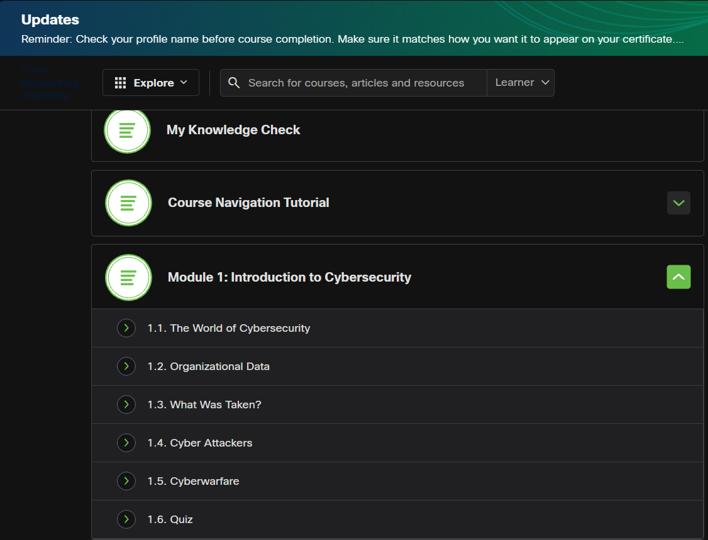

# Day 01 — Why Cybersecurity Matters

**Date:** 2026-11-04  
**Status:** Completed  
**Time spent:** 3 hours

## 1. What I studied
- I studied the fundamentals of cybersecurity, including the three pillars of the cybersecurity operational framework:
1. **People** - It means the human element, such as employees and users. Because most attacks involve people, social awareness and training are the first line of defence.
2. **Process** - It means the rules and regulations that an organization follows to handle data, manage access, patch software, and respond to certain incidents.
3. **Technologies** - It means using new technologies like next-generation firewalls, antivirus programs, and intrusion detection systems to improve the way an organization protects its security.

## 2. Task checklist
- [x] Read/watched the learning material.
- [x] Completed the core task.
- [x] Recorded my observations and evidence.
- [x] Reviewed what I learned.

## 3. Hands-on work
**Threats that were surprising:**
- There were some surprising threats that I found while learning about them.
Some of those threats are:

1. **AI Agent** - There was a case in which an AI agent was set up to send messages and details in response to policies. Someone hacked it and browsed sensitive information about the policies and clients of that organization. The AI agent became an insider threat because it was not configured properly.

2. **Deepfake** - There were multiple cases of fake IDs being generated live to bypass verification systems such as face locks. Deepfakes are also being used to bypass verification processes. In some cases, deepfakes are used to send videos of loved ones as part of potential social engineering attacks.

**Result / observations:**
- Through this course, I observed that there is a growing number of threats. As technology grows, the potential threats grow with it. So, staying updated and having knowledge of recent attacks and threats gives us an upper hand in preparing for them and helps us build solid knowledge about them.

## 4. What I learned
1. I learned about the operational framework of cybersecurity, which consists of people, processes, and technologies.
2. I learned about what an attacker wants from an organization and how they try to infiltrate it.
3. I learned about the consequences an organization may face after a possible attack, such as the loss of data, money, and people's trust, and how this affects the organization.

## 5. Challenges and troubleshooting
I didn't face any issues on this day, as it was more of a theoretical course.

## 6. Evidence

*Screenshot showing the Cisco Networking Academy course page with Module 1: Introduction to Cybersecurity and its lessons.*

## 7. Next step
- The next step is to learn more about malware and research common types of malware.

## Reflection
**Confidence before (1–5):** 1  
**Confidence after (1–5):** 4  
**One-sentence summary:** In today's work, I got to know some fundamental things about how an organization is affected by a possible attack and how things depend on each other for a better operational framework.
