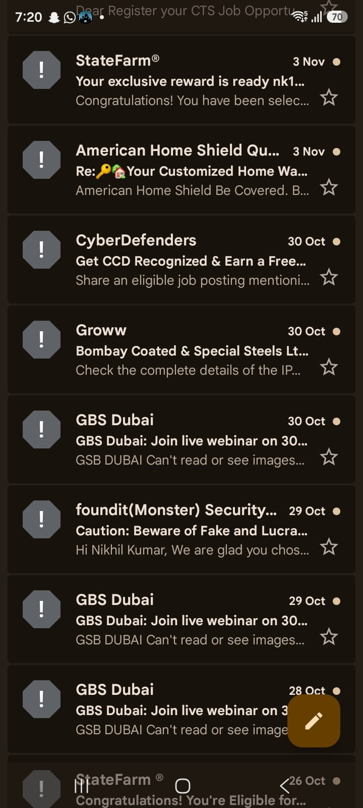
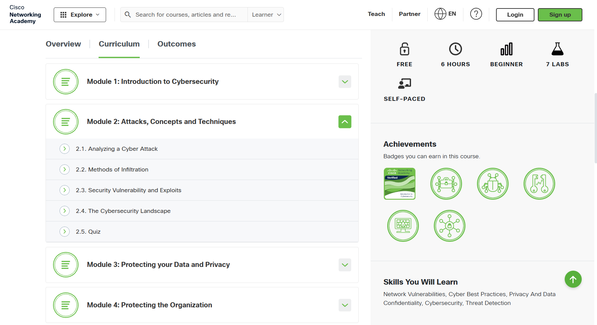

# Day 02 — Threats & Attack Types

**Date:** 2026-11-05  
**Status:** Completed  
**Time spent:** 2 hours

## 1. What I studied
- I studied malware and the different types of malware that can be used to hack or compromise different systems. I learned how malware works and how it affects a system.

## 2. Task checklist
- [x] Read/watched the learning material.
- [x] Completed the core task.
- [x] Recorded my observations and evidence.
- [x] Reviewed what I learned.

## 3. Hands-on work
- I worked on Network Tracer to configure a firewall virtually to block some IP addresses that I found malicious, so that they cannot access data from those IP addresses.

**Result / observations:**
- I observed that packets get blocked and learned how data can be transferred over a network.

## 4. What I learned
1. I learned about different types of malware:

   - **Virus** - It is malicious code written to get activated when clicked or opened by the user. This means it needs human interaction to get activated. Once it gets activated, it will do what it is meant to do.

   - **Worm** - It doesn't need human intervention. It travels from one system to another system by automatically finding vulnerabilities and trying to exploit them.

   - **Social engineering** - It is a way of pretending to be someone else to gain trust and exploit that trust to compromise the CIA triad.

   - **Trojan** - It is a type of malware that hides its true identity behind another application's identity. It may disguise a malicious file as part of an application or download.

2. Some of the ways to gain different types of access and information are:

   - **Brute force** - It is a way of using known and common passwords against a particular account again and again to gain access to that account.

   - **Password spraying** - It is a way in which a small list of common passwords is tried across multiple user accounts to gain access.

   - **SQL injection** - It is also a way to exploit a system's or company's database to compromise data that is not meant to be accessible to a particular user.

## 5. Challenges and troubleshooting
- While configuring the firewall, I used the UI because I don't know how to configure it through the terminal, but I am trying to learn how to do it.
- I also found some phishing emails in my inbox. They appeared to be mass phishing emails that were possibly intended to install a bot or something similar. I didn't open them.

## 6. Evidence

*Inbox screenshot showing email messages I identified for further phishing review. The messages were not opened.*

*Screenshot showing Module 2: Attacks, Concepts and Techniques, including its lessons.*

## 7. Questions to revisit
- I want to learn about the terminal setup of a firewall in an organization.

## 8. Next step
- In the next step, I am going to learn about the CIA triad in detail to understand how data can be protected from compromise.

## Reflection
**Confidence before (1–5):** 1  
**Confidence after (1–5):** 4  
**One-sentence summary:** Today, I learned about different types of malware and attack techniques, practised blocking malicious IP addresses with a virtual firewall, and became more aware of suspicious phishing emails.
