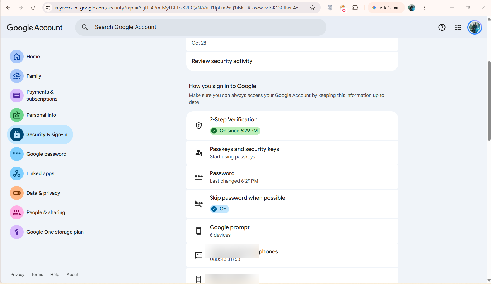
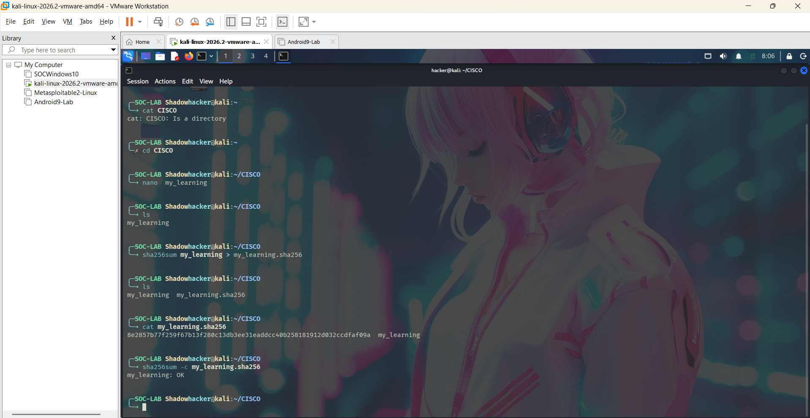
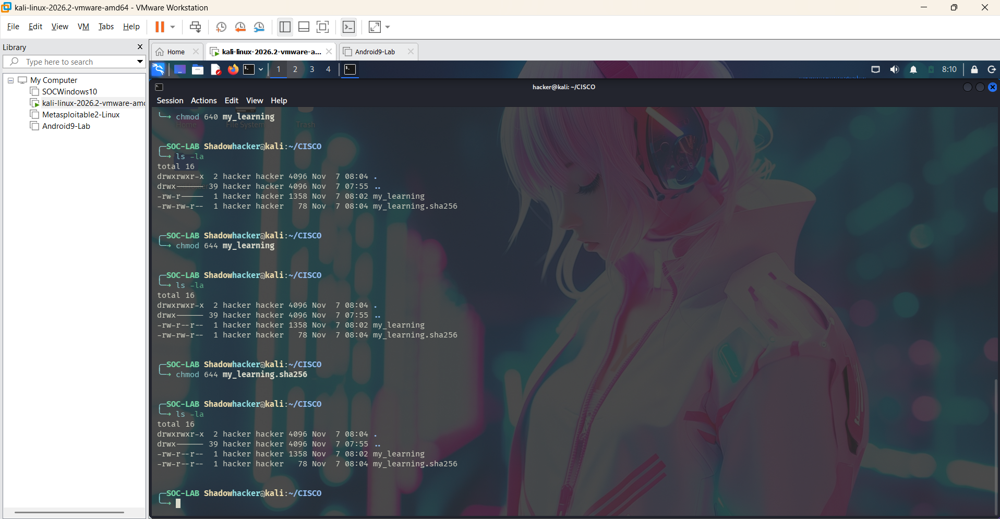

# Day 03 — The CIA Triad

**Date:** 2026-11-07  
**Status:** Completed  
**Time spent:** 3 hours

## 1. What I studied
- I studied the CIA triad and how it can be used to defend an organization against malicious attacks.

## 2. Task checklist
- [x] Read/watched the learning material.
- [x] Completed the core task.
- [x] Recorded my observations and evidence.
- [x] Reviewed what I learned.

## 3. Hands-on work
- I worked on my Google account to activate MFA (Multi-Factor Authentication) to make my login more secure. This uses the C (Confidentiality) component of the CIA triad.
- I generated a hash of a file named `my_learning` and stored it in a separate checksum file. I can check this file from time to time to verify its integrity. If the file is altered, its hash value changes.

## 4. Commands used and what they do

I used the following commands in Kali Linux while working in the `CISCO` directory.

| Command | What it does |
|---|---|
| `cat CISCO` | I tried to display `CISCO` with `cat`. The terminal showed that `CISCO` is a directory, so `cat` could not display it as a regular file. |
| `cd CISCO` | Changes the current directory to `CISCO`. |
| `nano my_learning` | Opens the Nano text editor to create or edit the `my_learning` file. |
| `ls` | Lists the files and directories in the current directory. |
| `sha256sum my_learning > my_learning.sha256` | Calculates the SHA-256 hash of `my_learning` and redirects the result into `my_learning.sha256`. |
| `cat my_learning.sha256` | Displays the saved SHA-256 checksum so I can inspect it. |
| `sha256sum -c my_learning.sha256` | Checks the file against the saved checksum. The output `my_learning: OK` means the file matches the saved hash. |
| `chmod 640 my_learning` | Sets permissions so the file owner can read and write it, the group can read it, and other users have no access. |
| `ls -la` | Lists all files, including hidden files, with detailed information such as permissions, owner, group, size, and modification time. |
| `chmod 644 my_learning` | Changes permissions so the owner can read and write the file, while the group and others can read it. |
| `chmod 644 my_learning.sha256` | Sets the checksum file so the owner can read and write it, while the group and others can read it. |

**Note:** I first set `my_learning` to `640`, then changed it to `644`. The final `644` setting allows all local users to read the file. For sensitive data, I should choose permissions carefully and avoid granting broader access than necessary.

## 5. Steps and observations

First, for confidentiality, I opened my Google Account security settings and turned on 2-Step Verification to add an extra layer of security to my account.

For the second part, I created a file named `my_learning` and stored some data in it. I configured it so that the group on that system could access the file and view its details, but I did not grant the group users write access. I generated the file's hash and stored it in a separate checksum file. I checked the hash to see whether the file had been changed.

**Result / observations:**
- I saw how powerful MFA can be in maintaining the confidentiality of data.
- I observed that the hash generated by the system stays the same until the data is altered. This way, we can confirm the integrity of the file by matching its hash with the stored hash. However, if someone can change both the file and the stored hash, this check alone may not detect the change.

## 6. What I learned
1. I learned about the three main components of the CIA triad:

   **C — Confidentiality**

   It means that data is confidential and should not be accessible to people who do not need it or have permission to access it. In simple terms, data must be accessible only to authorized people. If a file is important enough that its contents should be accessible only to people who have permission, such as an admin or CEO, other users, such as employees or guests, should not be able to access it because the data is confidential.

   **I — Integrity**

   It means that the content of the data is maintained as it should be. For example, if a user has Rs. 1,000 in a bank account, the account should continue to show Rs. 1,000 unless more money is added or an authorized transaction changes the balance. This is integrity. It means that data cannot be changed unless the change is approved in the system or file, and the data should maintain its integrity at all times. It must not be changed as a result of compromise or an attack.

   **A — Availability**

   It means that data must be accessible to those who are authorized or eligible to access it under different circumstances, whether during high demand or at any other time. For example, a bank's server should be available whenever we need to transfer money to someone else or make a request to check our balance. It should be available to provide the data whenever needed.

2. Controls that can provide defence for the CIA triad:

   **C — Confidentiality**

   We can add MFA, encryption, and access-based management for accessing certain data, so that access is authorized only for the people who have permission.

   **I — Integrity**

   For integrity, we can add a hash value to a file and share the file in an encrypted way so that we can check whether the file has been tampered with during transfer. The hashes should match if the file has not been altered. We can also use permissions, such as read-only permission, for users who need to access the data but are not allowed to change its contents.

   **A — Availability**

   We can add backups for data so that it can be available in case of a ransomware attack.

   We can use distributed servers to maintain availability for users if a server in one city goes down because of a disaster or other reasons, such as an attack.

   We can add a load balancer to direct requests so that data remains available to users in case of a failure in a single server or site.

3. The CIA triad also helps when developing software and deciding how to manage user access. It makes it easier to explain to investors or other non-technical members what could happen if any one of the CIA triad components is compromised.

## 7. Evidence

### Evidence 1 — Google Account 2-Step Verification

*Shows that 2-Step Verification is enabled on the Google Account. Phone-number details have been blurred for privacy.*

### Evidence 2 — Creating the file and verifying its SHA-256 hash

*Shows the `my_learning` file being created, the SHA-256 checksum being generated and displayed, and the checksum check returning `my_learning: OK`.*

### Evidence 3 — Changing and checking file permissions

*Shows the `chmod` commands and `ls -la` output used to view the file permissions.*

## 8. Questions to revisit
- I will revisit the MFA section to learn how I can generate it myself and implement it for my own data.

## 9. Next step
- I would like to learn about passwords and MFA in detail on the next day.

## Reflection
**Confidence before (1–5):** 1  
**Confidence after (1–5):** 4  
**One-sentence summary:** Today, I learned how the CIA triad protects confidentiality, integrity, and availability, and practised applying these principles through 2-Step Verification, SHA-256 hash verification, and Linux file permissions.
