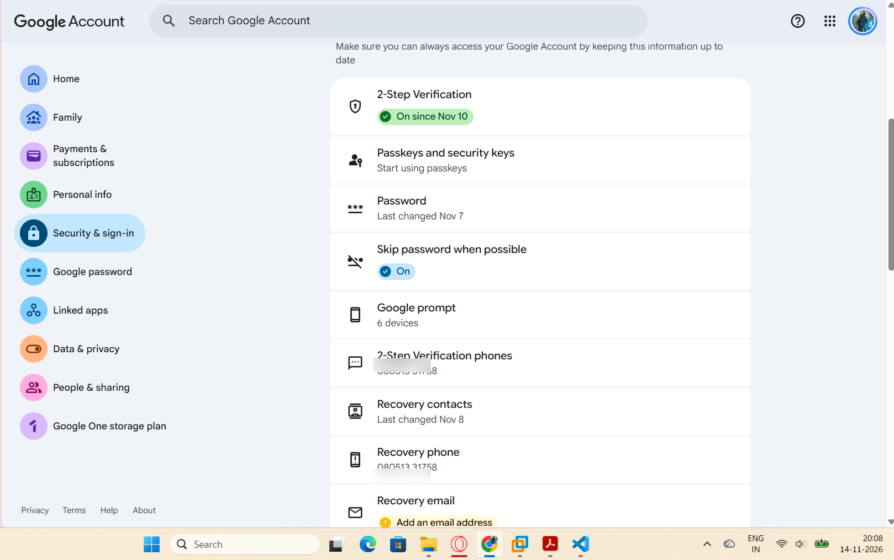
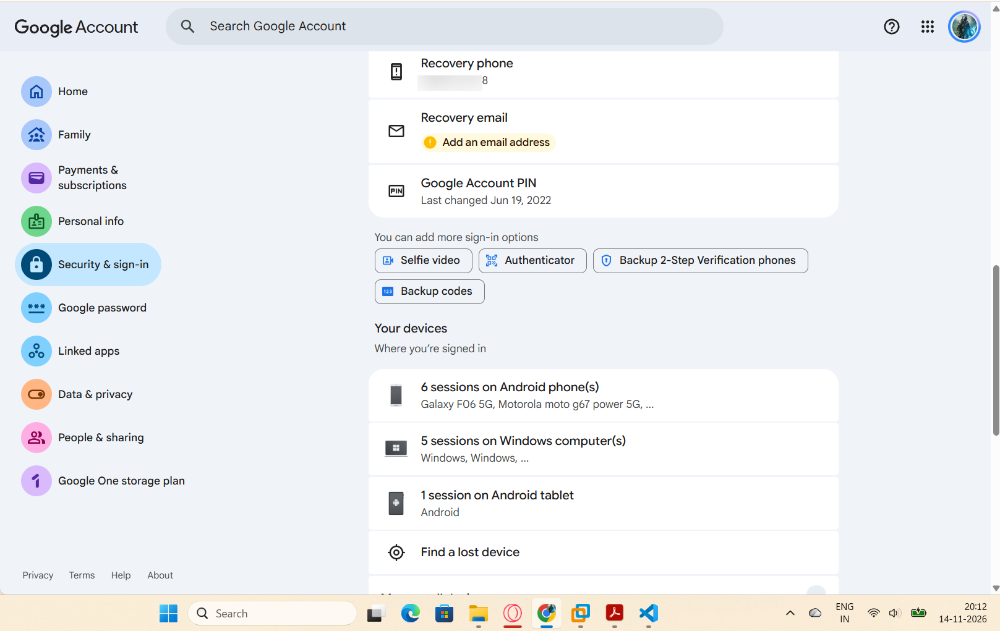

# Day 04 — Passwords & MFA

**Date:** 2026-11-14  
**Status:** Completed  
**Time spent:** 60 minutes

## 1. What I studied
- **MFA (Multi-Factor Authentication):** I studied the benefits of MFA, the methods used to authenticate users, and how MFA helps secure logins.
- **Single Sign-On (SSO):** I learned how SSO allows users to access multiple applications after signing in once, while MFA can add an extra layer of protection to that sign-in process.
- **Reduced costs:** MFA can help reduce the costs associated with compromised accounts by making unauthorized access harder. When combined with SSO, it can also reduce password-reset requests and the support effort needed to manage multiple logins.
- **Easier logins:** SSO makes logging in easier because users can access multiple authorized applications without entering their credentials separately for each one. MFA helps keep this convenient access more secure.

## 2. Task checklist
- [x] Read/watched the learning material.
- [x] Completed the core task.
- [x] Recorded my observations and evidence.
- [x] Reviewed what I learned.

## 3. Hands-on work
- I worked on my Google account and enabled MFA to make it more secure.

## 4. Steps or commands used
1. Opened my Google Account.
2. Went to **Security & sign-in**.
3. Opened the **2-Step Verification** option.
4. Set up a second way to verify my identity.

## 5. Result / observations
- 2-Step Verification was successfully enabled for my Google Account.
- My account now requires an additional verification step when I sign in, helping Google verify that it is really me.

## 6. What I learned
1. I learned that MFA is a great way to protect an account from phishing and unauthorized access because it requires two or more factors to authenticate a user before they can log in to an app or service.

2. MFA uses different authentication factors:

   - **Knowledge — something that I know:** For example, a password or PIN. These provide knowledge-based authentication.
   - **Possession — something that I have:** For example, a phone, security key, or authenticator device. This proves that I have access to a specific device or item used for verification.
   - **Inherence — something that I am:** For example, biometrics such as a fingerprint or retina scan, which can help verify my identity.

3. A modern verification method is **TOTP (Time-Based One-Time Password)**. It generates a temporary password that is valid for a short period. An authenticator app generates the code using a shared secret and the current time, and the user enters it to verify their identity.

4. With MFA, two or more authentication factors are used to verify my identity. This makes it harder for a hacker to log in even if one piece of information, such as my password, is known.

5. There are many benefits of MFA:
   - It helps protect accounts, servers, and data from unauthorized access.
   - It adds another layer of security if a password is stolen or exposed.
   - When used with SSO, it can support easier access to multiple applications while keeping the sign-in process protected.

## 7. Evidence

*Screenshot showing that 2-Step Verification is enabled on my Google Account.*

*Screenshot showing additional verification options, including an authenticator, backup verification phones, and backup codes.*

## 8. Questions to revisit
- I want to learn about some more modern methods of MFA.

## 9. Next step
- Next, I will study cryptography basics, endpoint security, and explore file and data encryption.

## Reflection
**Confidence before (1–5):** 2  
**Confidence after (1–5):** 5  
**One-sentence summary:** Today, I learned how MFA and SSO can make account access both easier and more secure, and I enabled Google 2-Step Verification to add another layer of protection to my account.
